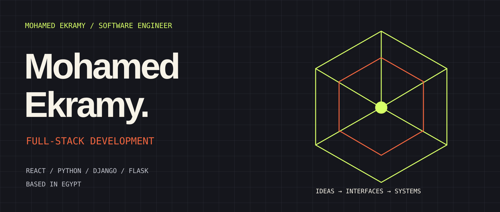
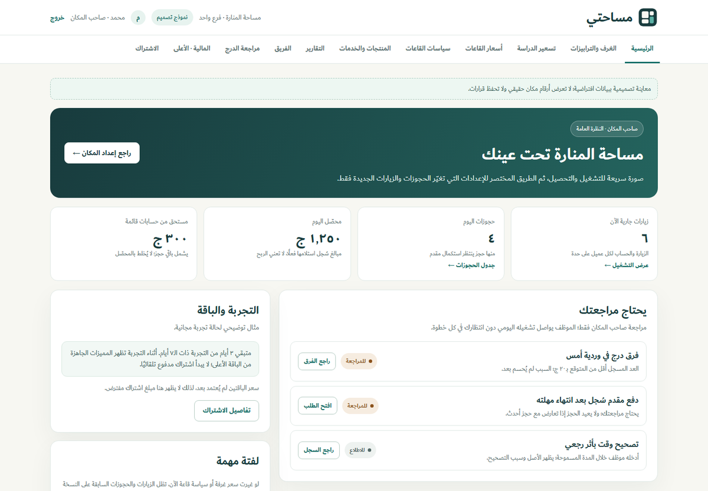
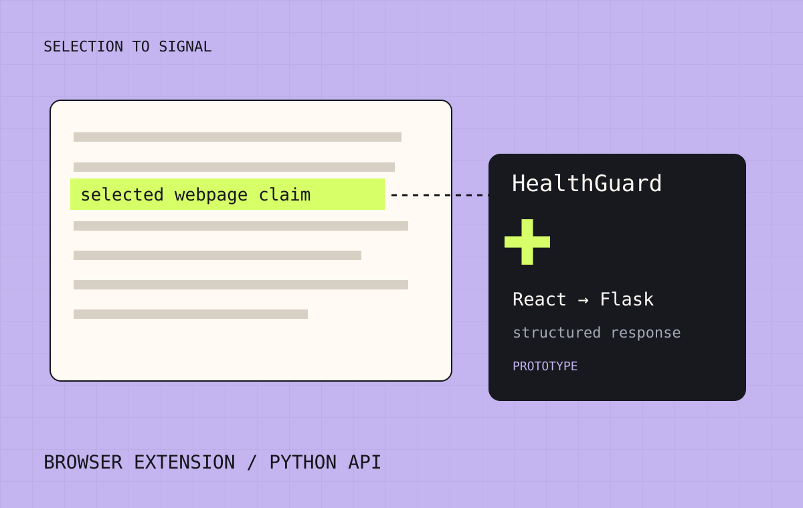
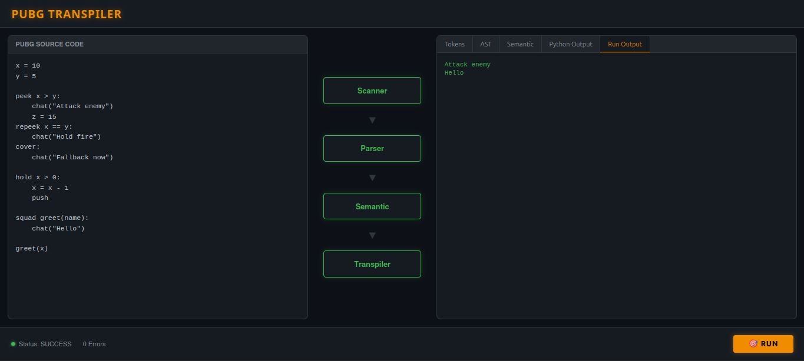
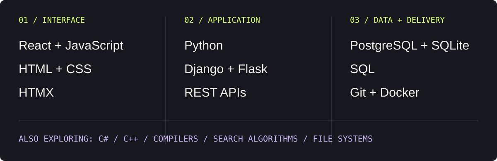

I build across **interfaces, application logic, and databases**. I'm a Software Engineering undergraduate at **Assiut National University**, graduating in **2027**, with a **CGPA of 3.76**.

My work also takes me into compilers, search algorithms, and file systems. I like understanding what happens underneath the interface.

## 01 / Currently building

### Masahati · مساحتي

**A platform for the spaces we study and work in.**

I'm building owner, staff, customer, and platform workflows for study and coworking spaces: seating, timed visits, bookings, checkout, and day-to-day operations.

`Python` `Django` `HTMX` `PostgreSQL`

**In development.** The image is a product design preview using fictional demo data. [Explore the project](https://mohamed-ekramy-portfolio.vercel.app/#project-masahati) · Private source repository.

## 02 / From idea to implementation

<table>
<tr>
<td width="50%" valign="top">

<h3>HealthGuard</h3>

A Manifest V3 Chrome extension that captures selected webpage claims and connects a React popup to a Flask analysis API.

<code>React</code> <code>JavaScript</code> <code>Flask</code> <code>Hugging Face</code>

<a href="https://mohamed-ekramy-portfolio.vercel.app/#project-healthguard">Project notes ↗</a> · Private source

</td>
<td width="50%" valign="top">

<h3>PUBG Language Transpiler and Web IDE</h3>

A custom-language compiler pipeline with a React/Vite interface for exploring tokens, the AST, semantic checks, generated Python, and output.

<code>Python</code> <code>React</code> <code>Vite</code> <code>REST API</code>

<a href="https://mohamed-ekramy-portfolio.vercel.app/#project-pubg">Project notes ↗</a> · <a href="https://github.com/MohamedKhedrawy/pubg/tree/final">Repository / final branch (access required) ↗</a>

</td>
</tr>
</table>

HealthGuard is an educational prototype with optional zero-shot classification and a rule-based mock fallback. It is not clinically validated. Repository links labeled private or requiring access do not imply public source availability.

## 03 / Engineering underneath

| Project | What I explored | Technologies |
| :--- | :--- | :--- |
| **AI Search and Game Algorithm Projects** | Pathfinding with Greedy Best-First Search, A*, Hill Climbing, and a Genetic Algorithm; Minimax Tic-Tac-Toe with three difficulty levels | Python · Search algorithms · Minimax |
| [**College Attendance System**](https://github.com/Mo7amed-Ekramy/Attendance-System) | An attendance-application foundation with Identity workflows for registration, email confirmation, password recovery, and two-factor authentication | C# · .NET 8 · ASP.NET Core MVC · EF Core · SQL Server |
| [**Librarium**](https://github.com/Mo7amed-Ekramy/flask_project) | Member/admin library workflows, catalog search and filtering, borrowing, returns, due dates, and system diagrams | Python · Flask · SQLite · Docker |
| **MiniFAT Virtual File System Shell** | A 1 MB virtual FAT file system with a 13-command interactive shell | Python · File allocation tables · CLI |

## 04 / My toolbox

<strong>Education and training</strong>

- **B.Sc. in Software Engineering** — Assiut National University, Faculty of Computers and Artificial Intelligence. Expected 2027 · CGPA 3.76.
- **DEPI / Data Engineering** — Dec 2025 - Jul 2026. Databases, SQL, ETL concepts, and data processing.
- **NTI / Python** — Jun 2026 - Jul 2026. Python, OOP, problem solving, and data structures.

## Let's build something good.

I'm open to **full-stack internships, junior roles, and interesting collaborations**.

[mohamedekramy2510@gmail.com](mailto:mohamedekramy2510@gmail.com) · [LinkedIn](https://www.linkedin.com/in/mohamed-ekramy25/) · [Portfolio](https://mohamed-ekramy-portfolio.vercel.app/)
