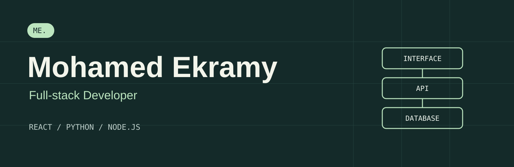

  <a href="https://mohamed-ekramy-portfolio.vercel.app/">Portfolio</a> &nbsp;·&nbsp;
  <a href="https://www.linkedin.com/in/mohamed-ekramy25/">LinkedIn</a> &nbsp;·&nbsp;
  <a href="mailto:mohamedekramy2510@gmail.com">Email</a> &nbsp;·&nbsp;
  <a href="https://mohamed-ekramy-portfolio.vercel.app/assets/Mohamed_Ekramy_CV.pdf">Resume</a>

## Hi, I'm Mohamed

I build web applications with **React, Python, and Node.js**, connecting user interfaces to APIs and databases. My projects cover library workflows, browser extensions, interactive workspaces, and data dashboards.

I'm a **Software Engineering undergraduate at Assiut National University**, graduating in **2027**, with a **CGPA of 3.76**. I'm interested in full-stack internship and junior opportunities.

## Selected work

| Project | What I built | Stack |
| :--- | :--- | :--- |
| [**Book Buddy**](https://github.com/Mo7amed-Ekramy/library-management-system) | Library UI and REST APIs for catalog search, borrowing, returns, and role-based access | React · TypeScript · Express · MySQL |
| [**Librarium**](https://github.com/Mo7amed-Ekramy/flask_project) | Member and admin library workflows, catalog filtering, loan history, and due dates | Python · Flask · SQLite · Docker |
| **HealthGuard** | Chrome extension prototype connecting selected webpage claims to a Python analysis API; private source | React · Manifest V3 · Flask · Hugging Face |
| [**Daemon**](https://github.com/Mo7amed-Ekramy/deamonDemo) · [Demo](https://daemon-frontend-nine.vercel.app/) | Interactive marketing workspace with campaign planning and creative previews | React · Vite · Browser storage |

HealthGuard is an educational prototype with an optional inference service and a rule-based mock fallback; it is not clinically validated. Daemon is a frontend demo with simulated agent responses, account flows, approvals, and publishing.

**Also explore:** [Rental Countdown](https://github.com/Mo7amed-Ekramy/Rental) ([live demo](https://rental-nine-inky.vercel.app/)), a mobile-first browser timer tool, and [Flight Delay Explorer](https://github.com/Mo7amed-Ekramy/Delay-Prediction), a Streamlit prediction and explanation dashboard.

[**Viva Hurghada**](https://vivahurghada.fun/) is a public travel site with tour information and WhatsApp booking inquiries. [**Edumad**](https://edumad-ekramy.vercel.app/) is an early HTML/CSS landing-page exercise with visual-only sign-in controls.

## My toolkit

| Area | Technologies |
| :--- | :--- |
| Frontend | JavaScript, React, HTML, CSS, Vite |
| Backend | Python, Flask, Node.js, Express.js, REST APIs, JWT |
| Data | SQL, MySQL, SQLite, MongoDB, pandas, scikit-learn |
| Workflow | Git, GitHub, Docker, Docker Compose |

## Learning through building

- **DEPI - Data Engineering** · Dec 2025 - Jul 2026: databases, SQL, ETL concepts, and data processing.
- **NTI - Python** · Jun 2026 - Jul 2026: Python, OOP, problem solving, and data structures.
- I enjoy tracing a feature through the whole application: the interface, request handling, data model, and the result a user sees.

Have a full-stack opportunity or a project to discuss? **[Let's talk](mailto:mohamedekramy2510@gmail.com).**
